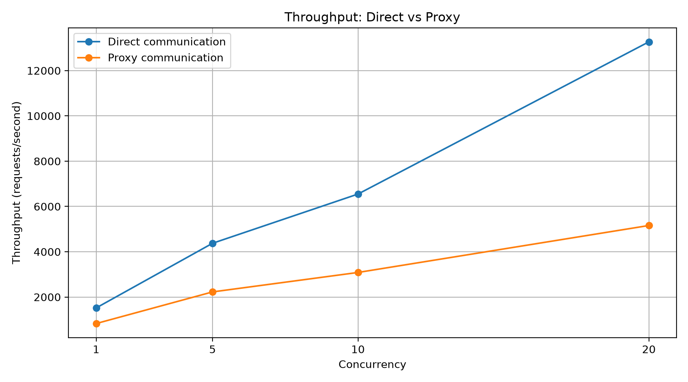
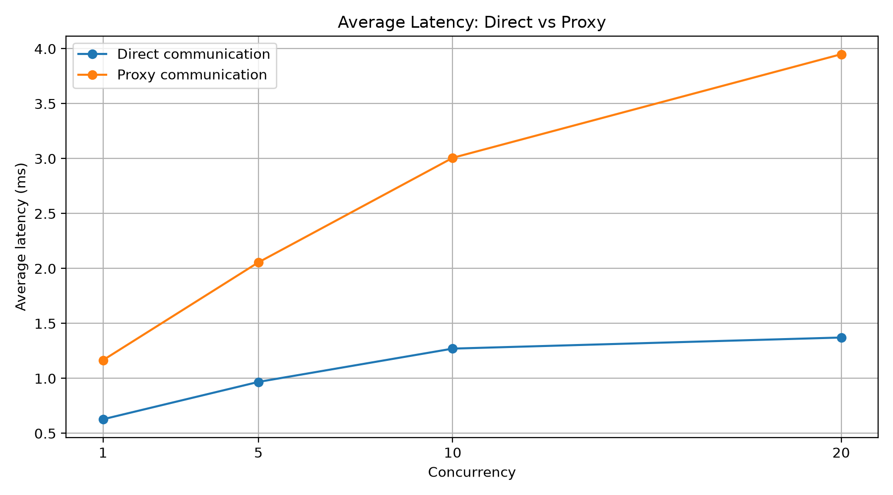

# Performance Evaluation

## 1. Objective

The objective of this experiment is to evaluate the performance of the TCP proxy by comparing direct client-to-backend communication with communication through the proxy.

The evaluation considers throughput, average latency, median latency, P95 latency and request success rate.

## 2. Experimental Methodology

Two configurations were evaluated:

- Direct communication: Client communicates directly with the backend server.
- Proxy-enabled communication: Client sends requests through the TCP proxy before reaching the backend.

Experiments were conducted at concurrency levels of 1, 5, 10 and 20.

The benchmark program used was `experiments/benchmark.py`.

The following metrics were recorded:

- Throughput: Number of successful requests processed per second.
- Average latency: Mean time taken to complete a request.
- Median latency: Middle value of the measured request latencies.
- P95 latency: 95th percentile of request latency.
- Success rate: Percentage of requests completed successfully.

## 3. Direct Communication Results

| Concurrency | Requests | Throughput (req/s) | Average latency (ms) | Median (ms) | P95 (ms) | Success |
|---:|---:|---:|---:|---:|---:|---:|
| 1 | 10 | 1518.95 | 0.628 | 0.335 | 2.440 | 100% |
| 5 | 50 | 4374.03 | 0.968 | 0.410 | 3.033 | 100% |
| 10 | 100 | 6547.83 | 1.271 | 0.964 | 2.718 | 100% |
| 20 | 500 | 13269.83 | 1.372 | 1.114 | 3.013 | 100% |

## 4. Proxy Communication Results

| Concurrency | Requests | Throughput (req/s) | Average latency (ms) | Median (ms) | P95 (ms) | Success |
|---:|---:|---:|---:|---:|---:|---:|
| 1 | 10 | 829.41 | 1.166 | 0.378 | 5.775 | 100% |
| 5 | 50 | 2226.78 | 2.056 | 0.754 | 13.636 | 100% |
| 10 | 100 | 3085.82 | 3.007 | 1.410 | 16.641 | 100% |
| 20 (Run 1) | 500 | 3466.04 | 5.601 | 2.292 | 3.890 | 100% |
| 20 (Run 2) | 500 | 6119.25 | 3.132 | 2.244 | 3.483 | 100% |
| 20 (Run 3) | 500 | 5893.83 | 3.117 | 2.486 | 4.200 | 100% |

### Average of three proxy runs at concurrency 20

- Throughput: 5159.71 requests/second.
- Average latency: 3.950 ms.
- Median latency (mean of run medians): 2.34 ms.
- Mean P95 latency: 3.858 ms.
- Success rate: 100%.

## 5. Direct vs Proxy Comparison at Concurrency 20

| Metric | Direct | Proxy |
|---|---:|---:|
| Throughput | 13269.83 req/s | 5159.71 req/s |
| Average latency | 1.372 ms | 3.950 ms |
| Median latency | 1.114 ms | 2.34 ms |
| P95 latency | 3.013 ms | 3.858 ms |
| Success rate | 100% | 100% |

The proxy-enabled setup showed approximately 2.578 ms additional average latency compared with the direct setup.

The measured throughput was approximately 61.1% lower in the proxy-enabled setup.

Both configurations achieved a 100% success rate in the final comparison datasets.

## 6. Observations

1. Direct communication achieved higher throughput in the measured experiments.
2. Proxy communication introduced additional latency due to the additional processing and forwarding layer.
3. Both configurations successfully handled the tested requests.
4. Proxy throughput and latency varied across repeated concurrency-20 experiments.
5. Repeated measurements are important for understanding performance variability.

## 7. Experimental Limitations

The direct and proxy experiments used separate Mininet topologies. Therefore, the measured difference represents the overhead of the overall proxy-enabled setup and not an isolated measurement of proxy processing alone.

The direct concurrency-20 comparison uses one final run, whereas the proxy concurrency-20 result is averaged across three runs.

These limitations should be considered when interpreting the measurements.

## 8. Conclusion

The experiments demonstrate that the proxy-enabled setup successfully handled concurrent requests while introducing measurable performance overhead compared with direct communication.

The benchmark results provide a quantitative evaluation of throughput, latency and request success rate under different concurrency levels.
## 9. Performance Graphs

### Throughput Comparison

### Average Latency Comparison

